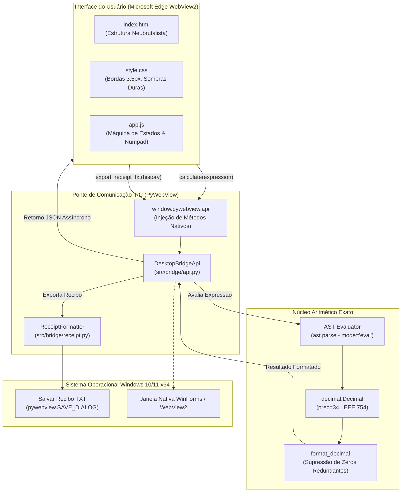

# ⚡ Calculator Fan — Desktop App (Windows 10/11 x64)

> **Calculadora Desktop Neubrutalista de Alta Precisão**, portada com 100% de paridade estética e funcional a partir da aplicação web original, operando como aplicativo Windows nativo sem dependência de servidores HTTP locais.

[](https://microsoft.com)
[](https://python.org)
[](https://pywebview.flowrl.com)
[](https://pyinstaller.org)
[](https://jrsoftware.org/isinfo.php)
[](tests/)

---

## 🎯 Destaques do Projeto

* **🎨 Estética Neubrutalista Rigorosa:** Bordas pretas espessas (3.5px a 4px), sombras sólidas sem blur (`box-shadow: 4px 4px 0px #121212`), cores vibrantes (#FFE600 amarelo brutalista, #FF5E7E rosa choque, #5CE1E6 ciano, #00E676 verde neon).
* **🖥️ Aplicativo Desktop Autônomo:** Executável nativo empacotado em modo `--onedir` com inicialização instantânea e suporte a Per-Monitor DPI Awareness V2.
* **🔒 IPC Direto Sem Portas de Rede:** Substituição integral do servidor HTTP (FastAPI/Uvicorn) por ponte IPC direta via Edge WebView2 (`window.pywebview.api`). Zero portas TCP/UDP abertas, imune a conflitos de porta ou bloqueios por firewall.
* **🧮 Motor Decimal AST Seguro (IEEE 754 decimal128):** Cálculo com precisão de 34 dígitos via `decimal.Decimal` e validação estrita em Abstract Syntax Tree (`ast`). Impede anomalias clássicas de ponto flutuante binário (`0.1 + 0.2 = 0.3`) e bloqueia qualquer tentativa de injeção de código.
* **🧾 Bobina de Recibo (Tape Drawer):** Histórico de cálculo em sessão volátil com gaveta deslizante expansível e exportação em `.txt` através de diálogo nativo do Windows Explorer.
* **⌨️ Mapeamento Ergonômico de Teclado:** Suporte completo a teclados físicos e Numpad, com normalização automática de vírgula para ponto no padrão ABNT2.
* **📦 Instalador Profissional Windows:** Script Inno Setup 6 compilando o instalador `CalculatorFan_Setup_x64.exe` com detecção de registro do WebView2 Evergreen (`HKLM`/`HKCU`), atalhos no Desktop/Menu Iniciar e desinstalador limpo.

---

## 🏛️ Arquitetura do Sistema



---

## 📁 Estrutura de Diretórios

```text
Calculator Fan - App/
├── build_scripts/                  # Automação de empacotamento e instalador
│   ├── assets/
│   │   └── app_icon.ico            # Ícone multi-resolução (16x16 a 256x256)
│   ├── calculator_fan.spec         # Especificação PyInstaller (--onedir, --windowed)
│   └── installer_inno.iss          # Script de instalação Inno Setup 6 (x64)
├── dist/                           # Binários gerados
│   ├── calculator_fan/             # Pasta de distribuição onedir do executável
│   │   ├── calculator_fan.exe      # Executável principal
│   │   └── _internal/              # Bibliotecas de runtime e assets
│   └── CalculatorFan_Setup_x64.exe # Instalador para Windows 10/11 x64 (~14 MB)
├── docs/                           # Documentação e especificações de engenharia
│   └── designs/
│       ├── calculator_fan_desktop.md # Documento de Design de Engenharia (RFC)
│       └── SITEMAP.md              # Mapa do projeto e requisitos
├── src/                            # Código-fonte da aplicação
│   ├── bridge/                     # Ponte IPC e exportação
│   │   ├── api.py                  # API exposta ao JavaScript
│   │   └── receipt.py              # Formatador de recibo fiscal/fita
│   ├── core/                       # Motor aritmético
│   │   └── engine.py               # Avaliador AST e precisão Decimal
│   ├── ui/                         # Interface gráfica (Frontend)
│   │   ├── css/
│   │   │   └── style.css           # Folha de estilos Neubrutalista
│   │   ├── js/
│   │   │   └── app.js              # Controlador de eventos e comunicação IPC
│   │   └── index.html              # Layout HTML semântico
│   └── main.py                     # Ponto de entrada Desktop (PyWebView launcher)
├── tests/                          # Suíte de testes automatizados
│   ├── test_bridge_api.py          # Testes da ponte IPC e do recibo
│   └── test_engine.py              # Testes do motor aritmético AST
├── concepts_brief.md               # Resumo conceitual do projeto
├── requirements.txt                # Dependências Python do projeto
└── README.md                       # Documentação principal
```

---

## ⌨️ Mapeamento de Atalhos de Teclado

A aplicação aceita entrada nativa tanto pelo teclado convencional quanto pelo teclado numérico dedicado (Numpad):

| Tecla / Combinação | Ação Executada |
| :--- | :--- |
| `0` a `9` | Digitação do dígito numérico correspondente |
| `+`, `-`, `*`, `/` | Inserção do operador aritmético |
| `.` ou `,` | Ponto decimal (vírgula ABNT2 é normalizada automaticamente) |
| `Enter` ou `=` | Avaliação da expressão (`calculate`) |
| `Backspace` | Exclusão do último caractere (`DEL`) |
| `Escape` ou `C` / `c` | Limpeza completa da tela (`C`) |
| `(` e `)` | Abertura e fechamento de parênteses |
| `r` ou `R` | Abertura/fechamento da gaveta do recibo |

---

## 🚀 Instalação e Execução

### Opção 1: Usando o Instalador Windows (Recomendado para Usuários)

1. Execute o instalador `dist/CalculatorFan_Setup_x64.exe`.
2. Siga o assistente de instalação (disponível em Português do Brasil).
3. O instalador verifica a presença do Microsoft Edge WebView2 Evergreen Runtime e cria o atalho no Menu Iniciar e na Área de Trabalho.
4. Execute o aplicativo diretamente pelo atalho.

### Opção 2: Execução Direta do Binário Portável

Navegue até `dist/calculator_fan/` e dê um duplo clique em `calculator_fan.exe`.

### Opção 3: Execução em Ambiente de Desenvolvimento (Python)

#### 1. Pré-requisitos
* Python 3.10 ou superior instalado no Windows 10/11 x64.
* Microsoft Edge WebView2 Runtime (nativo nas versões modernas do Windows 10 e 11).

#### 2. Instalação das dependências
```powershell
pip install -r requirements.txt
```

#### 3. Iniciar o aplicativo
```powershell
python src/main.py
```

---

## 🧪 Execução da Suíte de Testes

Os testes cobrem tanto o motor aritmético (`tests/test_engine.py`) quanto a camada de integração IPC e geração de recibos (`tests/test_bridge_api.py`):

```powershell
python -m pytest tests/ -v
```

Saída esperada:
```text
tests/test_bridge_api.py::test_bridge_calculate_success PASSED
tests/test_bridge_api.py::test_bridge_calculate_division_by_zero PASSED
tests/test_bridge_api.py::test_bridge_calculate_syntax_error PASSED
tests/test_bridge_api.py::test_bridge_export_receipt_window_not_initialized PASSED
tests/test_bridge_api.py::test_bridge_export_receipt_cancelled PASSED
tests/test_bridge_api.py::test_bridge_export_receipt_success PASSED
tests/test_bridge_api.py::test_format_receipt_text_empty PASSED
tests/test_engine.py::test_basic_arithmetic PASSED
tests/test_engine.py::test_decimal_precision_ieee754 PASSED
tests/test_engine.py::test_formatting_no_scientific_notation_for_integers PASSED
tests/test_engine.py::test_operator_precedence_and_parentheses PASSED
tests/test_engine.py::test_unary_operators PASSED
tests/test_engine.py::test_division_by_zero PASSED
tests/test_engine.py::test_security_rejection_of_unauthorized_nodes PASSED
tests/test_engine.py::test_visual_operator_sanitization PASSED
tests/test_engine.py::test_edge_cases PASSED

============================== 16 passed in 0.21s ==============================
```

---

## 🔨 Compilação e Geração do Instalador

### 1. Compilação do Executável com PyInstaller

Para gerar a pasta `dist/calculator_fan/`:
```powershell
python -m PyInstaller build_scripts/calculator_fan.spec --clean --noconfirm
```

### 2. Geração do Instalador com Inno Setup

Com o [Inno Setup 6](https://jrsoftware.org/isinfo.php) instalado:
```powershell
& "$env:LOCALAPPDATA\Programs\Inno Setup 6\ISCC.exe" build_scripts/installer_inno.iss
```
O arquivo gerado estará disponível em `dist/CalculatorFan_Setup_x64.exe`.

---

## 📄 Licença

Distribuído sob a licença MIT. Consulte o arquivo de licença para mais detalhes.
